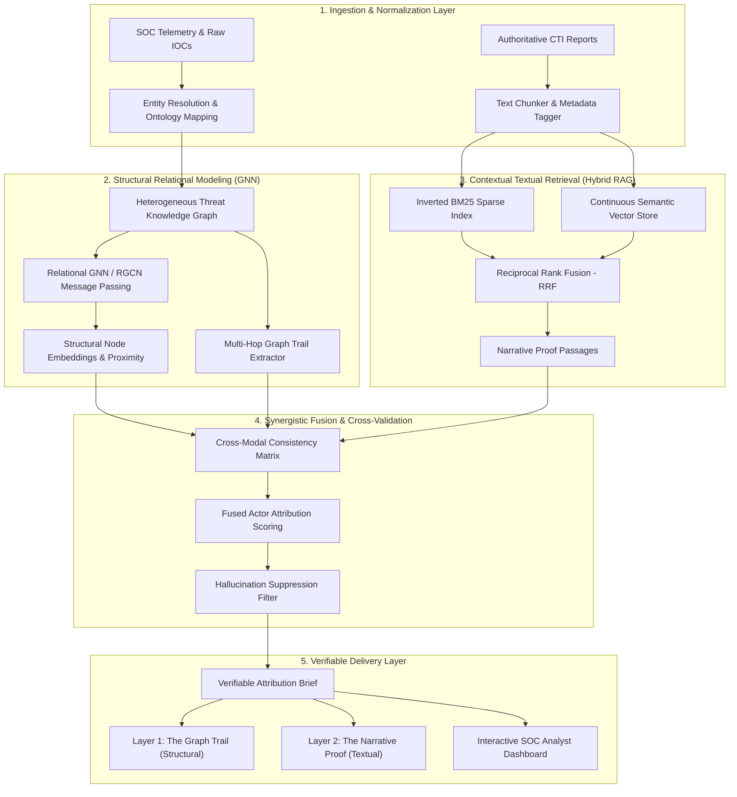

# 🏛️ NexusCTI: Architectural Design Blueprint

NexusCTI is a hybrid multi-modal cyber-threat attribution engine designed to solve the critical deficiencies in siloed attribution systems:
1. **Vector-only Retrieval-Augmented Generation (RAG)** excels at processing unstructured text reports, but fails at multi-hop structural reasoning across disparate indicators (e.g. pivoting through reverse DNS, shared subnets, and code-signing certificates).
2. **Graph Neural Networks (GNNs)** capture topological relationships and latent neighborhood proximity, but lack rich semantic context, geopolitical intent, tool modifications, and explanatory narratives.

NexusCTI bridges both paradigms through a unified, synergistic architecture with **Dual-Layer Validation** (`The Graph Trail` + `The Narrative Proof`).

---

## 1. High-Level System Architecture



---

## 2. Component Specifications

### 2.1 Heterogeneous Threat Knowledge Graph (HTKG)
- **Node Types $\mathcal{V}$:**
  - `ThreatActor`: Advanced Persistent Threat groups (e.g., APT28, APT29, Lazarus, Sandworm, FIN7, Volt Typhoon).
  - `Malware`: Malicious software families and backdoors (e.g., SUNBURST, Zebrocy, AppleJeus, NotPetya).
  - `Indicator`: Technical artifacts (IPv4 addresses, domain names, SHA256 hashes, URLs).
  - `TTP`: MITRE ATT&CK techniques (e.g., T1195.002, T1566.001, T1078, T1059.001).
  - `Vulnerability`: Common Vulnerabilities and Exposures (e.g., CVE-2021-44228, CVE-2020-1472).
- **Relation Types $\mathcal{R}$:**
  - `uses` / `rev_uses` (Actor $\leftrightarrow$ Malware)
  - `executes` / `rev_executes` (Actor $\leftrightarrow$ TTP)
  - `targets` / `rev_targets` (Actor $\leftrightarrow$ Vulnerability)
  - `controls` / `rev_controls` (Actor $\leftrightarrow$ Indicator)
  - `communicates_with` / `rev_communicates_with` (Malware $\leftrightarrow$ Indicator)
  - `exploits` (Malware $\rightarrow$ Vulnerability)
  - `maps_to` (Malware $\rightarrow$ TTP)
  - `resolves_to` / `rev_resolves_to` (Domain $\leftrightarrow$ IP)
  - `shares_infra` (Indicator $\leftrightarrow$ Indicator)

### 2.2 Relational Message Passing (HeteroThreatGNN)
The structural embedding of node $i$ at layer $l+1$ is updated via relation-specific message passing:

$$h_i^{(l+1)} = \text{LayerNorm}\left( W_{\text{self}}^{(l)} h_i^{(l)} + \sum_{r \in \mathcal{R}} \sum_{j \in \mathcal{N}_i^r} \frac{1}{c_{i,r}} W_r^{(l)} h_j^{(l)} \right)$$

where:
- $W_r^{(l)} \in \mathbb{R}^{d \times d}$ is the relation-specific transformation parameter tensor.
- $\mathcal{N}_i^r$ denotes the set of neighbors of node $i$ under relation $r$.
- $c_{i,r} = |\mathcal{N}_i^r|$ is the target-node degree normalization constant.
- $W_{\text{self}}$ is the residual self-connection matrix.

### 2.3 Hybrid Dense-Sparse RAG (Reciprocal Rank Fusion)
To ensure both exact indicator matching (preventing false drops of specific hashes or CVEs) and semantic conceptual understanding (geopolitical objectives, tool evolution):
- **Sparse BM25 Index:** Tokenizes with CTI-specific preservation (IP addresses, defanged dots `[.]`, CVE identifiers).
- **Dense Vector Store:** Subword hash n-gram projection into continuous embedding space with cosine similarity.
- **Reciprocal Rank Fusion (RRF):**
  $$RRF\_Score(d) = \sum_{m \in \{\text{dense}, \text{sparse}\}} \frac{w_m}{k + \text{rank}_m(d)}$$
  where $k=60$, $w_{\text{sparse}}=0.60$, $w_{\text{dense}}=0.40$.

### 2.4 Synergistic Fusion & Cross-Validation
The final attribution confidence score for each candidate Threat Actor $A$ is calculated through multi-modal synergistic fusion:

$$Score(A) = \alpha \cdot P_{\text{GNN}}(A) + \beta \cdot P_{\text{RAG}}(A) + \gamma \cdot C_{\text{score}}(A)$$

Where:
- $\alpha = 0.45$ (Structural topological confidence)
- $\beta = 0.35$ (Textual retrieval evidence confidence)
- $\gamma = 0.20$ (Cross-modal validation bonus)
- $C_{\text{score}}(A)$ measures the extent to which entities along the discovered Graph Trail are explicitly corroborated by the retrieved text passages.

---

## 3. Directory Layout & Module Structure

```
NexusCTI/
├── requirements.txt            # System dependencies
├── start_server.py             # Launches FastAPI Web Dashboard (port 8000)
├── run_benchmark.py            # Executes live 12-case empirical evaluation
├── run_demo.py                 # CLI demonstration for arbitrary IOC attribution
├── ARCHITECTURE.md             # This blueprint
├── RESEARCH_REPORT.md          # Comprehensive academic research report
├── nexuscti/
│   ├── config.py               # Hyperparameters, paths, thresholds
│   ├── service.py              # Central singleton coordinator
│   ├── data/
│   │   ├── ontology.py         # Node, Edge, and STIX/ATT&CK types
│   │   ├── knowledge_base.py   # Curated HTKG entities and multi-hop edges
│   │   └── corpus.py           # Authoritative vendor reports (CISA, Mandiant)
│   ├── gnn/
│   │   ├── graph_builder.py    # NetworkX & PyTorch tensor constructor
│   │   ├── model.py            # HeteroThreatGNN relational message passing
│   │   ├── trainer.py          # Representation learning & topological inference
│   │   └── trail_extractor.py  # Multi-hop Dijkstra path tracer
│   ├── rag/
│   │   ├── chunker.py          # Technical narrative sliding window chunker
│   │   ├── bm25_retriever.py   # CTI-tailored sparse BM25 retriever
│   │   ├── dense_retriever.py  # PyTorch semantic continuous vector retriever
│   │   └── hybrid_retriever.py # Reciprocal Rank Fusion & evidence extraction
│   ├── fusion/
│   │   ├── engine.py           # Synergistic fusion & consistency matrix
│   │   └── report_generator.py # Dual-layer Markdown & JSON report synthesis
│   └── eval/
│       ├── benchmark_cases.py  # 12 standardized 1-hop to 4-hop challenge cases
│       ├── baselines.py        # Naive Vector RAG & Standalone GNN baselines
│       └── evaluator.py        # Top-1/Top-5 accuracy, multi-hop depth, MRR
└── web/
    ├── index.html              # Cyber-defense SOC dashboard UI
    ├── style.css               # Futuristic glassmorphic dark theme
    └── app.js                  # Workbench, interactive canvas, live benchmarks
```
